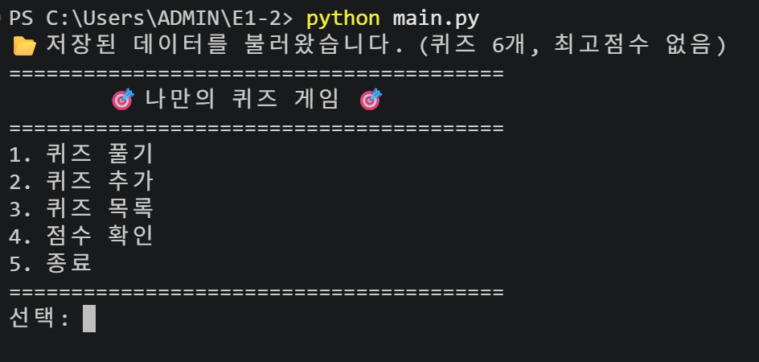
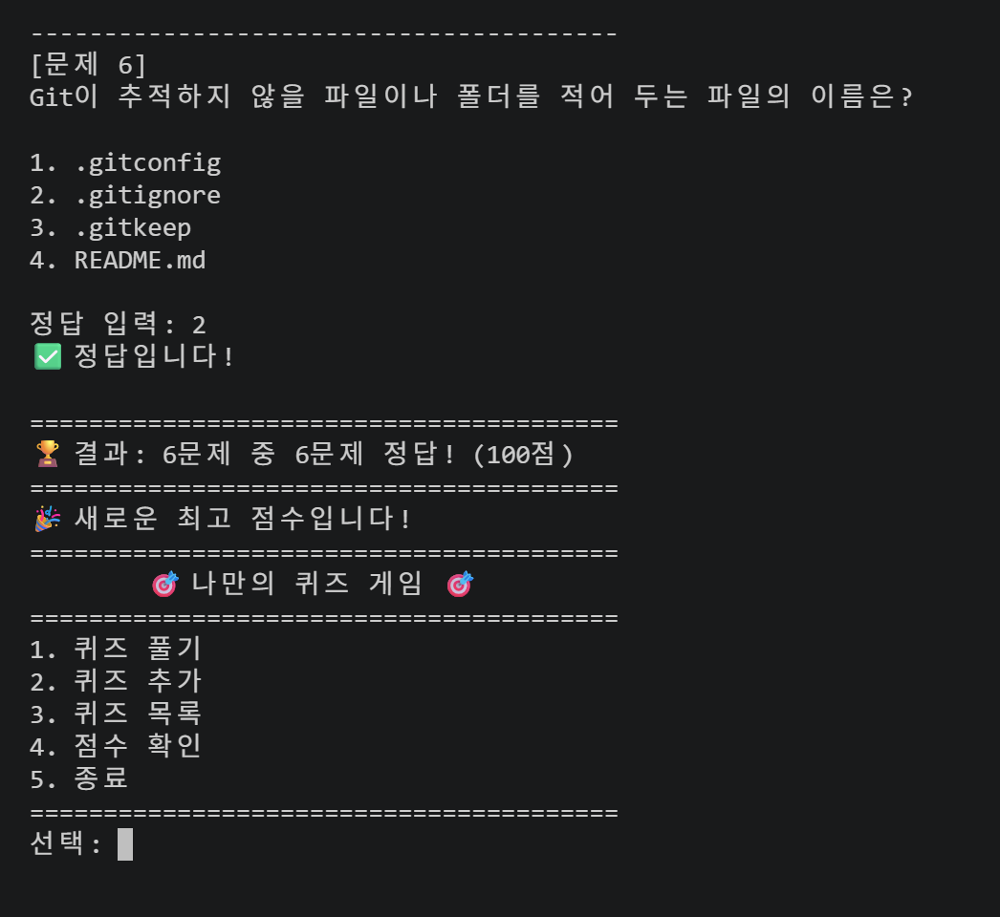
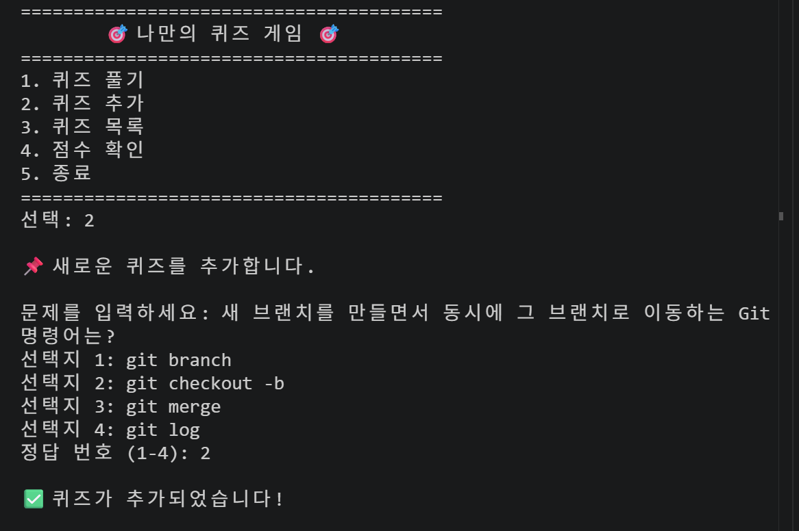
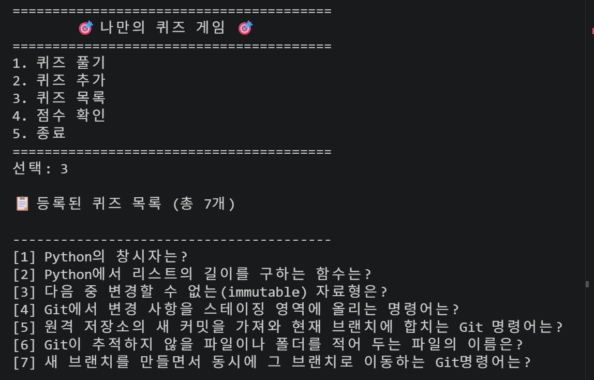
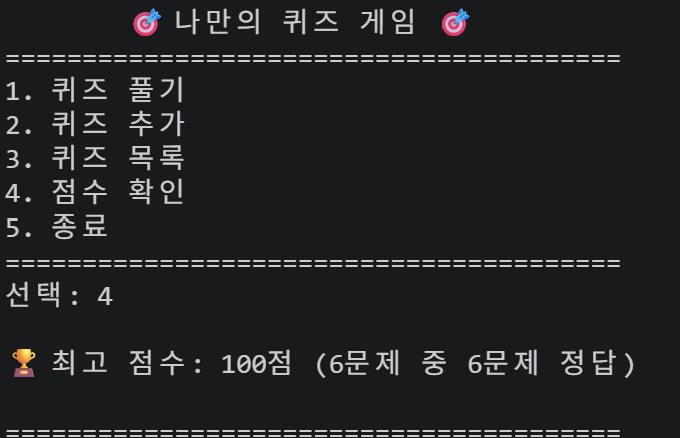
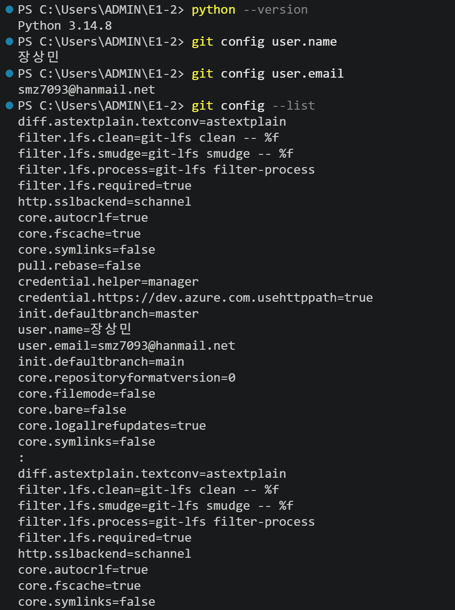
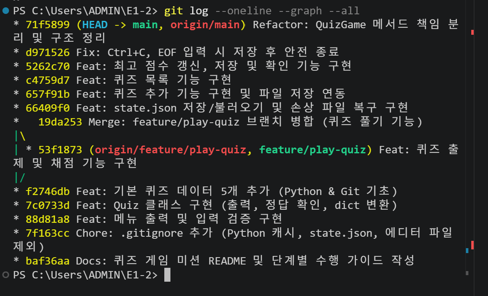

# 🎯 나만의 퀴즈 게임 (Python 콘솔 퀴즈 + Git 실습)

> 대전 이노베이션아카데미 AI 과정 미션: **Python 기초 · 클래스 · 파일 입출력 · Git**을 직접 써 보면서 동작하는 프로그램 하나를 처음부터 끝까지 완성합니다.

이 문서는 두 부분으로 되어 있습니다.

- **Part A. 제출용 README 항목**: 과제에서 꼭 넣으라고 한 항목(개요, 주제 선정 이유, 실행 방법, 기능 목록, 파일 구조, 데이터 파일 설명)
- **Part B. 미션 수행 가이드**: 0단계부터 13단계까지 순서대로 따라 하면 미션을 마칠 수 있게 정리한 과정 (코드 + Git 명령어 + 개념 설명)

> 💡 Part A는 이 프로젝트의 최종 설명이고, Part B는 단계별로 실제 수행한 과정을 기록한 것입니다.

---

# Part A. 제출용 README

## 1. 프로젝트 개요

터미널에서 실행하는 객관식 퀴즈 게임입니다. 메뉴에서 번호를 골라 **퀴즈 풀기 / 퀴즈 추가 / 퀴즈 목록 / 점수 확인 / 종료**를 할 수 있습니다.
퀴즈와 최고 점수는 `state.json` 파일에 저장되기 때문에 프로그램을 껐다가 다시 켜도 그대로 남아 있습니다.

- 언어: Python 3.10 이상 (외부 라이브러리 없이 표준 라이브러리만 사용)
- 구조: `Quiz`(문제 한 개), `QuizGame`(게임 전체 관리) 두 클래스로 역할을 나눔
- 버전 관리: Git / GitHub (기능 단위 커밋, 브랜치 생성과 병합, clone/pull 실습)

## 2. 퀴즈 주제와 선정 이유

**주제: Python & Git 기초**

- 이 미션에서 배우는 내용(Python 문법, 자료형, Git 명령어)을 문제로 만들면 만드는 동안 자연스럽게 복습이 됩니다.
- 정답이 분명한 개념형 문제라서 객관식 4지선다로 만들기 좋습니다.
- 퀴즈 추가 기능으로 공부하면서 새로 알게 된 내용을 계속 문제로 쌓아 갈 수 있습니다. (예: 직접 추가한 `.gitignore` 문제)

| 번호 | 기본 퀴즈 | 분류 |
|---|---|---|
| 1 | Python의 창시자는? | Python |
| 2 | Python에서 리스트의 길이를 구하는 함수는? | Python |
| 3 | 다음 중 변경할 수 없는(immutable) 자료형은? | Python |
| 4 | Git에서 변경 사항을 스테이징 영역에 올리는 명령어는? | Git |
| 5 | 원격 저장소의 새 커밋을 가져와 현재 브랜치에 합치는 Git 명령어는? | Git |

## 3. 실행 방법

```bash
# 1) 저장소 복제
git clone https://github.com/smz7093-web/E1-2.git
cd E1-2

# 2) 파이썬 버전 확인 (3.10 이상)
python --version

# 3) 실행
python main.py
```

> Windows 터미널에서 이모지나 한글이 깨지면 `chcp 65001`을 먼저 실행하거나 VSCode 터미널을 사용하세요.

## 4. 기능 목록

| 번호 | 기능 | 설명 |
|---|---|---|
| 1 | 퀴즈 풀기 | 저장된 퀴즈를 차례로 내고 정답/오답을 알려 줍니다. 다 풀면 점수를 보여 주고 최고 점수를 갱신합니다. |
| 2 | 퀴즈 추가 | 문제, 선택지 4개, 정답 번호를 입력받아 새 퀴즈를 등록하고 바로 파일에 저장합니다. |
| 3 | 퀴즈 목록 | 등록된 퀴즈의 문제를 번호와 함께 보여 줍니다. |
| 4 | 점수 확인 | 최고 점수를 보여 줍니다. 아직 푼 적이 없으면 안내 메시지를 띄웁니다. |
| 5 | 종료 | 데이터를 저장하고 끝냅니다. |

**예외 처리**
- 입력 앞뒤 공백 제거(`" 1 "` → `1`)
- 숫자가 아닌 입력(`abc`), 범위 밖 숫자(`9`, `0`), 빈 입력(Enter만 누름)은 안내 메시지를 띄우고 다시 입력받음
- `Ctrl+C`(KeyboardInterrupt)나 입력 스트림 종료(EOFError)가 일어나면 저장한 뒤 안전하게 종료
- `state.json`이 없으면 기본 퀴즈 사용, 손상되었으면 안내 메시지를 띄우고 기본 퀴즈로 복구

## 5. 파일 구조

```
E1-2/
├── main.py              # 프로그램 시작점 (QuizGame 생성 후 run 호출)
├── quiz.py              # Quiz 클래스: 문제 1개 (출력, 정답 확인, dict 변환)
├── quiz_game.py         # QuizGame 클래스: 메뉴, 게임 진행, 입력 처리, 저장/불러오기
├── default_quizzes.py   # 기본 퀴즈 5개 (Quiz 인스턴스로 생성)
├── state.json           # 실행 중에 자동 생성되는 데이터 파일 (Git에는 올리지 않음)
├── .gitignore
├── README.md
└── docs/
    └── screenshots/     # 제출용 실행 화면 캡처
        ├── dev_env.png      # 개발 환경 (Python 버전, Git 설정)
        ├── menu.png         # 메인 메뉴
        ├── play.png         # 퀴즈 풀기
        ├── add_quiz.png     # 퀴즈 추가
        ├── list.png         # 퀴즈 목록
        ├── score.png        # 점수 확인
        └── git_graph.png    # git log --graph 결과
```

**클래스/파일별 책임**

| 클래스/파일 | 책임 |
|---|---|
| `Quiz` (`quiz.py`) | 문제 1개의 데이터 + 출력 + 정답 확인 + dict 변환 |
| `QuizGame` (`quiz_game.py`) | 메뉴, 입력 검증, 게임 진행, 점수 관리, 파일 저장/불러오기 |
| `default_quizzes.py` | 기본 퀴즈 데이터 |
| `main.py` | 프로그램 시작점 |

## 6. 데이터 파일 설명 (`state.json`)

- **경로**: 프로젝트 루트(`main.py`와 같은 폴더)의 `state.json`
- **인코딩**: UTF-8 (`ensure_ascii=False`를 줘서 한글이 그대로 저장됨)
- **역할**: 퀴즈 목록과 최고 점수를 저장해서 프로그램을 다시 켜도 데이터가 남아 있게 함
- **생성 시점**: 퀴즈를 추가하거나, 최고 점수가 바뀌거나, 프로그램을 종료할 때 저장

| 키 | 타입 | 설명 |
|---|---|---|
| `quizzes` | list | 퀴즈 목록 |
| `quizzes[].question` | str | 문제 |
| `quizzes[].choices` | list[str] | 선택지 4개 |
| `quizzes[].answer` | int | 정답 번호 (1~4) |
| `best_score` | int 또는 null | 최고 점수(100점 만점), 아직 안 풀었으면 `null` |
| `best_correct` | int | 최고 점수를 냈을 때 맞힌 문제 수 |
| `best_total` | int | 최고 점수를 냈을 때 전체 문제 수 |

```json
{
    "quizzes": [
        {
            "question": "Python의 창시자는?",
            "choices": ["Guido van Rossum", "Linus Torvalds", "Bjarne Stroustrup", "James Gosling"],
            "answer": 1
        }
    ],
    "best_score": 80,
    "best_correct": 4,
    "best_total": 5
}
```

## 7. 실행 화면

| 메뉴 | 퀴즈 풀기 |
|---|---|
|  |  |
| **퀴즈 추가** | **퀴즈 목록** |
|  |  |
| **점수 확인** | **개발 환경** |
|  |  |

**Git 커밋 그래프** (`git log --oneline --graph --all`)



---

# Part B. 미션 수행 가이드 (단계별)

## 전체 흐름 한눈에 보기

| 단계 | 할 일 | 브랜치 | 커밋 메시지 예시 |
|---|---|---|---|
| 0 | 개발 환경 준비 | - | - |
| 1 | GitHub 저장소 생성 + 로컬 설정 | main | `Chore: 프로젝트 초기 설정 (.gitignore, README)` |
| 2 | 메뉴 + 입력 예외 처리 | main | `Feat: 메뉴 출력 및 입력 검증 구현` |
| 3 | Quiz 클래스 | main | `Feat: Quiz 클래스 구현` |
| 4 | 기본 퀴즈 데이터 | main | `Feat: 기본 퀴즈 데이터 5개 추가` |
| 5 | 퀴즈 풀기 ⭐브랜치 | **feature/play-quiz** → main | `Feat: 퀴즈 출제 기능 구현` + merge |
| 6 | 파일 저장/불러오기 | main | `Feat: state.json 저장/불러오기 구현` |
| 7 | 퀴즈 추가 | main | `Feat: 퀴즈 추가 기능 구현` |
| 8 | 퀴즈 목록 | main | `Feat: 퀴즈 목록 기능 구현` |
| 9 | 점수 확인 | main | `Feat: 최고 점수 저장 및 확인 기능 구현` |
| 10 | Ctrl+C / EOF 처리 | main | `Fix: Ctrl+C, EOF 입력 시 저장 후 안전 종료` |
| 11 | QuizGame 구조 정리 | main | `Refactor: QuizGame 메서드 책임 분리` |
| 12 | README 작성 + 최종 push | main | `Docs: README 작성` |
| 13 | clone / pull 실습 | main | `Docs: README에 clone 실습 내용 추가` |

이렇게 하면 커밋이 **12개 이상**이 되고, Git 명령어 7종(`init`, `add`, `commit`, `push`, `pull`, `checkout`, `clone`)을 모두 쓰게 됩니다.

> 🔑 **좋은 습관**: 단계마다 `python main.py`로 직접 실행해 보고, 동작을 확인한 다음에 커밋하세요. "동작하는 상태"마다 커밋을 남겨 두는 것이 Git을 쓰는 이유입니다.

---

## 0단계. 개발 환경 준비

### 할 일
1. **Python 3.10 이상** 설치 → 터미널에서 `python --version`
2. **Git** 설치 → `git --version`
3. **VSCode** 설치 + Python 확장 설치
4. **GitHub 계정** 만들기
5. Git 사용자 정보 등록 (처음 한 번만)

```bash
git config --global user.name "내이름"
git config --global user.email "github에-가입한-이메일"
git config --global init.defaultBranch main   # 새 저장소의 기본 브랜치를 main으로
git config --list                              # 설정 확인
```

### 📸 제출용 캡처 ①
VSCode 화면 + `python --version` + `git config --list` 결과가 함께 보이게 캡처해 두세요.

---

## 1단계. Git 저장소 설정 → 첫 커밋 & push

### 1-1. GitHub에서 새 저장소 만들기
- GitHub → **New repository** → 이름: `E1-2` → **Public**
- ⚠️ "Add a README file"은 **체크하지 마세요** (로컬에서 만들 거라 충돌이 납니다)

### 1-2. 로컬 폴더 만들고 `git init`

```bash
mkdir E1-2
cd E1-2
git init                 # ✅ init: 이 폴더를 Git 저장소로 만든다 (.git 폴더 생성)
```

### 1-3. `.gitignore`, `README.md` 만들기

`.gitignore` (Git이 추적하지 않을 파일 목록)
```gitignore
# Python 캐시
__pycache__/
*.pyc

# 실행 중 생성되는 데이터 파일 (사람마다 내용이 달라짐)
state.json

# 에디터/OS 파일
.vscode/
.DS_Store
Thumbs.db
```

> 💭 **state.json을 왜 무시할까?** 플레이할 때마다 내용이 바뀌는 "실행 결과"라서 코드와 성격이 다릅니다. 파일이 없어도 기본 퀴즈로 시작하게 만들 것이라(6단계) 문제없습니다. (올리고 싶으면 이 줄을 지워도 됩니다.)

`README.md`는 일단 제목 한 줄만 써도 됩니다.
```markdown
# 🎯 나만의 퀴즈 게임
```

### 1-4. 첫 커밋 → 원격 연결 → push

```bash
git status                                   # 어떤 파일이 바뀌었는지 확인
git add .gitignore README.md                 # ✅ add: 커밋할 파일을 스테이징 영역에 올림
git commit -m "Chore: 프로젝트 초기 설정 (.gitignore, README)"   # ✅ commit: 스냅샷 저장
git branch -M main                           # 브랜치 이름을 main으로 확정
git remote add origin https://github.com/smz7093-web/E1-2.git
git push -u origin main                      # ✅ push: 원격 저장소(GitHub)로 업로드
```

> `-u`는 "앞으로 이 브랜치는 origin/main과 연결"이라는 뜻입니다. 다음부터는 `git push`만 쳐도 됩니다.
> push할 때 로그인 창이 뜨면 GitHub 계정으로 로그인하세요 (Windows는 Git Credential Manager가 처리해 줍니다).

### 📚 개념: Git이란?
- **Git**은 파일의 변경 이력을 기록하는 **버전 관리 도구**입니다. "언제, 누가, 무엇을, 왜 바꿨는지"가 남아서 예전 상태로 돌아가거나 여러 사람이 동시에 작업할 수 있습니다.
- **작업 폴더 → (add) → 스테이징 영역 → (commit) → 로컬 저장소 → (push) → 원격 저장소(GitHub)** 순서로 흘러갑니다.

---

## 2단계. 메뉴 기능 + 공통 입력 처리

### 목표
- 실행하면 메뉴가 뜨고, 번호를 고르면 해당 기능으로 가고, 5번을 누르면 끝납니다.
- 잘못된 입력(공백, 문자, 범위 밖 숫자, 빈 입력)을 걸러 냅니다.

### 코드: `quiz_game.py` (뼈대)

```python
class QuizGame:
    """게임 전체(메뉴, 진행, 저장)를 관리하는 클래스"""

    def __init__(self):
        self.quizzes = []          # 퀴즈 목록 (list)
        self.best_score = None     # 최고 점수 (아직 없으면 None)

    # ---------- 입력 처리 ----------
    def get_number(self, prompt, min_value, max_value):
        """min_value~max_value 사이의 정수를 받을 때까지 반복해서 묻는다."""
        while True:                                   # 올바른 값이 들어올 때까지 반복 → while
            raw = input(prompt).strip()               # strip(): 앞뒤 공백 제거
            if raw == "":
                print("⚠️ 입력이 비어 있습니다. 다시 입력하세요.")
                continue                              # 반복문 처음으로 돌아감
            try:
                number = int(raw)                     # "abc"면 ValueError 발생
            except ValueError:
                print(f"⚠️ 잘못된 입력입니다. {min_value}-{max_value} 사이의 숫자를 입력하세요.")
                continue
            if not min_value <= number <= max_value:
                print(f"⚠️ 잘못된 입력입니다. {min_value}-{max_value} 사이의 숫자를 입력하세요.")
                continue
            return number                             # 올바른 값이면 반환하고 함수 종료

    # ---------- 메뉴 ----------
    def show_menu(self):
        print("=" * 40)
        print("        🎯 나만의 퀴즈 게임 🎯")
        print("=" * 40)
        print("1. 퀴즈 풀기")
        print("2. 퀴즈 추가")
        print("3. 퀴즈 목록")
        print("4. 점수 확인")
        print("5. 종료")
        print("=" * 40)

    def run(self):
        while True:
            self.show_menu()
            choice = self.get_number("선택: ", 1, 5)
            if choice == 1:
                print("(준비 중) 퀴즈 풀기")
            elif choice == 2:
                print("(준비 중) 퀴즈 추가")
            elif choice == 3:
                print("(준비 중) 퀴즈 목록")
            elif choice == 4:
                print("(준비 중) 점수 확인")
            else:
                print("👋 게임을 종료합니다. 안녕히 가세요!")
                break
```

### 코드: `main.py`

```python
from quiz_game import QuizGame


def main():
    game = QuizGame()   # 객체 생성 → __init__ 자동 실행
    game.run()


if __name__ == "__main__":   # 이 파일을 직접 실행할 때만 main() 호출
    main()
```

### 테스트
`python main.py`를 실행하고 ` 1 `, `abc`, `9`, (그냥 Enter), `5`를 차례로 입력해 보세요.

### 커밋
```bash
git add main.py quiz_game.py
git commit -m "Feat: 메뉴 출력 및 입력 검증 구현"
```

### 📚 개념 정리
- **변수**: 값에 이름을 붙여 저장하는 상자. `choice = 3`이라고 해 두면 나중에 `choice`라는 이름으로 그 값을 다시 쓸 수 있습니다.
- **자료형**
  | 타입 | 예 | 용도 |
  |---|---|---|
  | `int` | `3`, `100` | 정수 (정답 번호, 점수) |
  | `str` | `"Python의 창시자는?"` | 문자열 (문제, 선택지) |
  | `bool` | `True`, `False` | 참/거짓 (정답 여부) |
  | `list` | `["A", "B", "C", "D"]` | 순서 있는 여러 값 (선택지, 퀴즈 목록) |
  | `dict` | `{"question": "...", "answer": 1}` | 키-값 쌍 (JSON 저장 형태) |
- **if / elif / else**: 조건에 따라 다른 코드를 실행합니다 (메뉴 분기).
- **for vs while**
  - `for`: **반복 횟수가 정해져 있을 때** (퀴즈 5개를 하나씩 → `for quiz in quizzes`)
  - `while`: **조건이 만족될 때까지 반복할 때** (올바른 입력이 올 때까지, 종료를 누를 때까지)
- **함수/메서드, 매개변수, 반환값**: `get_number(prompt, 1, 5)`에서 `prompt, min_value, max_value`가 매개변수이고 `return number`가 반환값입니다. 범위만 바꿔서 메뉴(1~5)와 정답(1~4)에 같은 함수를 다시 씁니다.

---

## 3단계. Quiz 클래스

### 목표
퀴즈 한 문제를 **데이터(속성) + 동작(메서드)** 으로 묶습니다.

### 코드: `quiz.py`

```python
class Quiz:
    """퀴즈 한 문제를 표현하는 클래스"""

    def __init__(self, question, choices, answer):
        self.question = question    # str  : 문제
        self.choices = choices      # list : 선택지 4개
        self.answer = answer        # int  : 정답 번호 (1~4)

    def display(self, number):
        """문제와 선택지를 화면에 출력"""
        print("-" * 40)
        print(f"[문제 {number}]")
        print(self.question)
        print()
        for i, choice in enumerate(self.choices, start=1):   # 1부터 번호 붙이기
            print(f"{i}. {choice}")
        print()

    def is_correct(self, user_answer):
        """정답이면 True, 아니면 False (bool 반환)"""
        return user_answer == self.answer

    def to_dict(self):
        """JSON 저장용 dict로 변환"""
        return {"question": self.question, "choices": self.choices, "answer": self.answer}

    @classmethod
    def from_dict(cls, data):
        """dict(JSON에서 읽은 값) → Quiz 객체. 형식이 틀리면 ValueError"""
        question = data["question"]
        choices = data["choices"]
        answer = data["answer"]
        if not isinstance(question, str) or not isinstance(choices, list) or len(choices) != 4:
            raise ValueError("퀴즈 형식이 올바르지 않습니다.")
        if not isinstance(answer, int) or not 1 <= answer <= 4:
            raise ValueError("정답 번호가 올바르지 않습니다.")
        return cls(question, choices, answer)
```

> `to_dict` / `from_dict`는 6단계(파일 저장)에서 씁니다. 지금 미리 만들어 둬도 되고, 6단계에서 추가해도 됩니다.

### 커밋
```bash
git add quiz.py
git commit -m "Feat: Quiz 클래스 구현 (출력, 정답 확인)"
```

### 📚 개념 정리
- **클래스**: 객체를 찍어 내는 **설계도**. `Quiz`라는 설계도 하나로 문제 100개도 같은 모양으로 만들 수 있습니다.
- **객체(인스턴스)**: 설계도로 만든 실제 물건. `q1 = Quiz("문제", [...], 1)`에서 `q1`.
- **`__init__`**: 객체를 만들 때 **자동으로 한 번 실행**되는 초기화 메서드. 속성의 첫 값을 정합니다.
- **`self`**: "지금 이 메서드를 호출한 **바로 그 객체 자신**"입니다. `q1.is_correct(3)`을 호출하면 `self`는 `q1`이고, 그래서 `self.answer`는 `q1`의 정답입니다.
- **속성(attribute)**: 객체가 가진 데이터 (`self.question`). **메서드(method)**: 객체가 할 수 있는 동작 (`display()`).
- **왜 클래스를 쓸까?** 문제/선택지/정답을 각각 따로 리스트에 들고 다니면 순서가 어긋나기 쉽습니다. 하나로 묶으면 관리하기 쉽고, "퀴즈 출력"처럼 퀴즈에 관한 코드가 한곳에 모입니다.

---

## 4단계. 기본 퀴즈 데이터 (5개 이상)

### 코드: `default_quizzes.py`

```python
from quiz import Quiz


def get_default_quizzes():
    """기본 퀴즈 목록을 새로 만들어 반환 (Quiz 인스턴스 리스트)"""
    return [
        Quiz("Python의 창시자는?", ["Guido van Rossum", "Linus Torvalds", "Bjarne Stroustrup", "James Gosling"], 1),
        Quiz("Python에서 리스트의 길이를 구하는 함수는?", ["size()", "count()", "len()", "length()"], 3),
        Quiz("다음 중 변경할 수 없는(immutable) 자료형은?", ["list", "dict", "set", "tuple"], 4),
        Quiz("Git에서 변경 사항을 스테이징 영역에 올리는 명령어는?", ["git commit", "git add", "git push", "git pull"], 2),
        Quiz("JSON 파일을 파이썬 객체로 읽어오는 함수는?", ["json.dump()", "json.dumps()", "json.load()", "json.write()"], 3),
    ]
```

> ✏️ **내 주제로 직접 작성하세요!** 과제의 핵심 요구 중 하나가 "본인이 선택한 주제의 퀴즈를 직접 작성"하는 것입니다.

`quiz_game.py`의 `__init__`에서 기본 퀴즈를 불러오게 바꿉니다.

```python
from default_quizzes import get_default_quizzes

class QuizGame:
    def __init__(self):
        self.quizzes = get_default_quizzes()
        self.best_score = None
```

### 커밋
```bash
git add default_quizzes.py quiz_game.py
git commit -m "Feat: 기본 퀴즈 데이터 5개 추가"
```

---

## 5단계. 퀴즈 풀기 ⭐ (브랜치 생성 → 작업 → 병합)

이 단계가 **브랜치 실습**입니다.

### 5-1. 새 브랜치 만들고 이동

```bash
git checkout -b feature/play-quiz   # ✅ checkout: 브랜치 생성 + 이동
git branch                          # * feature/play-quiz 에 별표가 있으면 OK
```

### 5-2. 코드: `quiz_game.py`에 `play()` 추가

```python
    def play(self):
        if not self.quizzes:                       # 빈 리스트는 False로 취급
            print("📭 등록된 퀴즈가 없습니다. 먼저 퀴즈를 추가하세요.")
            return
        total = len(self.quizzes)
        correct = 0
        print(f"\n📝 퀴즈를 시작합니다! (총 {total}문제)\n")
        for number, quiz in enumerate(self.quizzes, start=1):   # 정해진 개수만큼 → for
            quiz.display(number)
            user_answer = self.get_number("정답 입력: ", 1, 4)
            if quiz.is_correct(user_answer):
                print("✅ 정답입니다!\n")
                correct += 1
            else:
                print(f"❌ 오답입니다. 정답은 {quiz.answer}번입니다.\n")
        score = int(correct / total * 100)
        print("=" * 40)
        print(f"🏆 결과: {total}문제 중 {correct}문제 정답! ({score}점)")
        print("=" * 40)
```

`run()`에서 1번을 연결합니다.
```python
            if choice == 1:
                self.play()
```

### 5-3. 브랜치에서 커밋 → main으로 병합 → push

```bash
git add quiz_game.py
git commit -m "Feat: 퀴즈 출제 및 채점 기능 구현"

git checkout main                    # main으로 돌아가기
git merge feature/play-quiz          # ✅ merge: 브랜치 작업을 main에 합치기
git push origin main
git push origin feature/play-quiz    # (선택) GitHub에도 브랜치 기록 남기기
```

> 💡 **merge 기록이 그래프에 선으로 보이게 하려면** `git merge --no-ff feature/play-quiz`를 쓰세요. 그냥 merge하면 "fast-forward"로 처리돼서 한 줄로 이어 붙고, `git log --graph`에 갈래가 보이지 않을 수 있습니다. 갈래가 보이는 편이 제출 캡처에 좋습니다.

### 📚 개념: 브랜치
- **브랜치**는 독립된 작업 공간입니다. main은 그대로 두고 새 기능을 따로 만들다가, 완성되면 합칩니다(merge).
- 팀 프로젝트에서는 "기능마다 브랜치 → PR → 코드 리뷰 → merge" 흐름으로 확장됩니다.

---

## 6단계. 파일 저장/불러오기 (`state.json`)

### 목표
- 시작할 때 `state.json`을 읽고, 데이터가 바뀌면 저장합니다.
- 파일이 **없으면** 기본 퀴즈를 쓰고, **손상되었으면** 안내 메시지를 띄운 뒤 기본 퀴즈로 복구합니다.

### 코드: `quiz_game.py` 위쪽과 메서드 추가

```python
import json
from pathlib import Path

from quiz import Quiz
from default_quizzes import get_default_quizzes

# 프로젝트 루트(이 파일이 있는 폴더)의 state.json
# → 어느 폴더에서 실행하든 같은 위치를 사용하게 됨
STATE_FILE = Path(__file__).parent / "state.json"


class QuizGame:
    def __init__(self):
        self.quizzes = []
        self.best_score = None
        self.best_correct = 0
        self.best_total = 0
        self.load()                      # 시작할 때 불러오기

    def load(self):
        if not STATE_FILE.exists():      # 첫 실행
            print("📂 저장된 데이터가 없어 기본 퀴즈로 시작합니다.")
            self.quizzes = get_default_quizzes()
            return
        try:
            with open(STATE_FILE, "r", encoding="utf-8") as f:
                data = json.load(f)                      # JSON 텍스트 → dict
            self.quizzes = [Quiz.from_dict(q) for q in data["quizzes"]]
            self.best_score = data.get("best_score")
            self.best_correct = data.get("best_correct", 0)
            self.best_total = data.get("best_total", 0)
            score_text = "없음" if self.best_score is None else f"{self.best_score}점"
            print(f"📂 저장된 데이터를 불러왔습니다. (퀴즈 {len(self.quizzes)}개, 최고점수 {score_text})")
        except (json.JSONDecodeError, KeyError, TypeError, ValueError):
            # JSON 문법이 깨짐 / 키가 없음 / 타입이 이상함 / 값이 범위 밖
            print("⚠️ 데이터 파일이 손상되어 기본 퀴즈로 복구합니다.")
            self.quizzes = get_default_quizzes()
            self.best_score = None
            self.best_correct = 0
            self.best_total = 0
            self.save()                                  # 정상 파일로 덮어쓰기
        except OSError as e:                             # 권한 문제 등 읽기 오류
            print(f"⚠️ 파일을 읽을 수 없습니다: {e}. 기본 퀴즈로 시작합니다.")
            self.quizzes = get_default_quizzes()

    def save(self):
        data = {
            "quizzes": [q.to_dict() for q in self.quizzes],   # Quiz 객체 → dict
            "best_score": self.best_score,
            "best_correct": self.best_correct,
            "best_total": self.best_total,
        }
        try:
            with open(STATE_FILE, "w", encoding="utf-8") as f:
                json.dump(data, f, ensure_ascii=False, indent=4)   # 한글 그대로, 보기 좋게
        except OSError as e:
            print(f"⚠️ 저장에 실패했습니다: {e}")
```

`run()`의 종료(5번) 부분에서 `self.save()`를 호출하세요.

### 테스트
1. 처음 실행하면 → "저장된 데이터가 없어…"가 뜨는지
2. 종료한 뒤 `state.json`이 생겼는지, 열어 보면 한글이 보이는지
3. `state.json` 내용을 `{깨진` 같은 걸로 바꾸고 실행하면 → "손상되어 기본 퀴즈로 복구"가 뜨는지

### 커밋
```bash
git add quiz.py quiz_game.py
git commit -m "Feat: state.json 저장/불러오기 및 손상 파일 복구 구현"
```

### 📚 개념 정리
- **파일 입출력 기본 과정**: ① `open()`으로 열기(모드 `"r"` 읽기 / `"w"` 쓰기) → ② 읽기/쓰기 → ③ 닫기.
  `with open(...) as f:` 블록을 쓰면 블록이 끝날 때 **자동으로 닫혀서** 안전합니다.
- **JSON**: `{"키": 값}` 형태의 **텍스트 데이터 형식**. 사람이 읽을 수 있고, 거의 모든 언어가 지원하며, 파이썬의 `dict`/`list`와 구조가 같아서 변환이 쉽습니다.
  - `json.dump(obj, f)`: 파이썬 객체 → 파일 / `json.load(f)`: 파일 → 파이썬 객체
- **왜 `to_dict`가 필요할까?** JSON은 `Quiz` 같은 우리가 만든 객체를 모릅니다. 그래서 저장할 때는 dict로 바꾸고, 읽을 때는 다시 `Quiz`로 바꿉니다.
- **try / except**: 오류가 날 수 있는 코드를 `try`에 넣고, 오류가 나면 프로그램이 죽지 않고 `except` 블록이 실행됩니다.

---

## 7단계. 퀴즈 추가

### 코드: `quiz_game.py`에 추가

```python
    def get_text(self, prompt):
        """빈 문자열이 아닌 텍스트를 받을 때까지 반복"""
        while True:
            text = input(prompt).strip()
            if text:
                return text
            print("⚠️ 빈 값은 입력할 수 없습니다.")

    def add_quiz(self):
        print("\n📌 새로운 퀴즈를 추가합니다.\n")
        question = self.get_text("문제를 입력하세요: ")
        choices = [self.get_text(f"선택지 {i}: ") for i in range(1, 5)]   # 4개 입력
        answer = self.get_number("정답 번호 (1-4): ", 1, 4)
        self.quizzes.append(Quiz(question, choices, answer))
        self.save()                                                       # 바로 파일에 저장
        print("\n✅ 퀴즈가 추가되었습니다!\n")
```

`run()`에서 `elif choice == 2: self.add_quiz()`로 연결하세요.

### 커밋
```bash
git add quiz_game.py
git commit -m "Feat: 퀴즈 추가 기능 구현 및 파일 저장 연동"
```

---

## 8단계. 퀴즈 목록

```python
    def list_quizzes(self):
        if not self.quizzes:
            print("📭 등록된 퀴즈가 없습니다.")
            return
        print(f"\n📋 등록된 퀴즈 목록 (총 {len(self.quizzes)}개)\n")
        print("-" * 40)
        for i, quiz in enumerate(self.quizzes, start=1):
            print(f"[{i}] {quiz.question}")
        print("-" * 40)
```

`run()`에서 `elif choice == 3: self.list_quizzes()`로 연결하세요.

```bash
git add quiz_game.py
git commit -m "Feat: 퀴즈 목록 기능 구현"
```

---

## 9단계. 점수 확인 (최고 점수 갱신 + 저장)

```python
    def update_best_score(self, score, correct, total):
        """이번 점수가 최고 점수보다 높으면 갱신하고 저장"""
        if self.best_score is None or score > self.best_score:
            self.best_score = score
            self.best_correct = correct
            self.best_total = total
            print("🎉 새로운 최고 점수입니다!")
            self.save()

    def show_score(self):
        if self.best_score is None:
            print("📭 아직 퀴즈를 풀지 않았습니다. 먼저 퀴즈를 풀어보세요!")
            return
        print(f"\n🏆 최고 점수: {self.best_score}점 ({self.best_total}문제 중 {self.best_correct}문제 정답)\n")
```

- `play()`의 결과 출력 부분에서 `self.update_best_score(score, correct, total)`을 호출하세요.
- `run()`에서 `elif choice == 4: self.show_score()`로 연결하세요.

> 💭 왜 `best_score`의 처음 값이 `0`이 아니라 `None`일까요? 0점을 받은 것과 **아직 한 번도 안 푼 것**을 구분하기 위해서입니다.

```bash
git add quiz_game.py
git commit -m "Feat: 최고 점수 갱신, 저장 및 확인 기능 구현"
```

---

## 10단계. Ctrl+C / EOF에도 안전하게 종료

`run()` 전체를 `try`로 감쌉니다.

```python
    def run(self):
        try:
            while True:
                self.show_menu()
                choice = self.get_number("선택: ", 1, 5)
                if choice == 1:
                    self.play()
                elif choice == 2:
                    self.add_quiz()
                elif choice == 3:
                    self.list_quizzes()
                elif choice == 4:
                    self.show_score()
                else:
                    self.save()
                    print("👋 게임을 종료합니다. 안녕히 가세요!")
                    break
        except (KeyboardInterrupt, EOFError):
            # Ctrl+C → KeyboardInterrupt / 입력 스트림 종료(Ctrl+Z, Ctrl+D 등) → EOFError
            print("\n\n⚠️ 입력이 중단되었습니다. 데이터를 저장하고 종료합니다.")
            self.save()
```

### 테스트
메뉴나 문제 풀이 중에 `Ctrl+C`를 눌러 보세요. 빨간 Traceback 대신 안내 메시지가 나오면 성공입니다.

```bash
git add quiz_game.py
git commit -m "Fix: Ctrl+C, EOF 입력 시 저장 후 안전 종료"
```

---

## 11단계. QuizGame 클래스 구조 정리 (Refactor)

기능이 다 붙었으면 코드를 한 번 훑으며 정리합니다.

**체크리스트**
- [ ] 메서드가 역할별로 묶여 있는가? (`# 입력 처리` / `# 파일 저장/불러오기` / `# 메뉴` / `# 기능` 같은 구역 주석)
- [ ] 한 메서드가 너무 많은 일을 하지 않는가? (예: 채점과 최고 점수 갱신을 `update_best_score`로 분리)
- [ ] 메뉴/정답 입력이 모두 `get_number()` 하나를 다시 쓰는가?
- [ ] 클래스와 메서드에 docstring(`"""설명"""`)이 있는가?
- [ ] 쓰지 않는 코드나 `print` 디버깅 흔적을 지웠는가?

**최종 역할 분리**

| 클래스/파일 | 책임 |
|---|---|
| `Quiz` (`quiz.py`) | 문제 1개의 데이터 + 출력 + 정답 확인 + dict 변환 |
| `QuizGame` (`quiz_game.py`) | 메뉴, 입력 검증, 게임 진행, 점수 관리, 파일 저장/불러오기 |
| `default_quizzes.py` | 기본 퀴즈 데이터 |
| `main.py` | 프로그램 시작점 |

### 실제로 정리한 내용

**① 기본값 복구 코드 중복 제거 → `reset_to_default()`로 분리**

`load()`의 첫 실행 / 손상 파일 / 읽기 오류 세 곳에서 같은 초기화 코드를 반복하던 것을 메서드 하나로 묶었습니다.

```python
    def reset_to_default(self):
        """퀴즈를 기본 퀴즈로, 최고 점수 기록을 초기 상태로 되돌린다."""
        self.quizzes = get_default_quizzes()
        self.best_score = None
        self.best_correct = 0
        self.best_total = 0

    def load(self):
        """state.json을 읽어 퀴즈와 최고 점수를 복원한다. (없거나 손상되면 기본값)"""
        if not STATE_FILE.exists():      # 첫 실행
            print("📂 저장된 데이터가 없어 기본 퀴즈로 시작합니다.")
            self.reset_to_default()
            return
        try:
            ...                                          # (불러오기 부분은 6단계와 같음)
        except (json.JSONDecodeError, KeyError, TypeError, ValueError):
            print("⚠️ 데이터 파일이 손상되어 기본 퀴즈로 복구합니다.")
            self.reset_to_default()
            self.save()                                  # 정상 파일로 덮어쓰기
        except OSError as e:
            print(f"⚠️ 파일을 읽을 수 없습니다: {e}. 기본 퀴즈로 시작합니다.")
            self.reset_to_default()
```

**② `get_number()`의 중복 오류 메시지 통합**

숫자가 아닐 때와 범위 밖일 때 똑같은 메시지를 두 번 쓰던 것을 한 곳에서 출력하도록 바꿨습니다.

```python
            try:
                number = int(raw)                     # "abc"면 ValueError 발생
            except ValueError:
                number = None                         # 숫자가 아님 → 아래에서 오류 처리
            if number is not None and min_value <= number <= max_value:
                return number
            print(f"⚠️ 잘못된 입력입니다. {min_value}-{max_value} 사이의 숫자를 입력하세요.")
```

**③ 모든 메서드에 docstring 추가** (`load`, `save`, `show_menu`, `run`, `add_quiz`, `list_quizzes`, `show_score`)

> 리팩터링은 **동작을 바꾸지 않고** 구조만 정리하는 것입니다. 정리한 뒤 모든 메뉴, 잘못된 입력, 손상 파일 복구를 다시 테스트해서 결과가 같은지 확인했습니다.

```bash
git add quiz_game.py      # 아직 커밋하지 않을 파일(캡처 등)이 섞이지 않게 파일을 지정
git commit -m "Refactor: QuizGame 메서드 책임 분리 및 구조 정리"
```

---

## 12단계. README 작성 → 최종 push

1. 이 문서의 **Part A** 항목을 내 주제에 맞게 고쳐 씁니다.
2. 실행 화면을 캡처해서 `docs/screenshots/`에 저장합니다. (`dev_env.png`, `menu.png`, `play.png`, `add_quiz.png`, `list.png`, `score.png`, `git_graph.png`)
   - Windows 캡처 단축키: `Win + Shift + S`

```bash
git add README.md docs/
git commit -m "Docs: README 작성 및 실행 화면 스크린샷 추가"
git push origin main
```

GitHub 저장소 페이지에서 README와 사진이 잘 보이는지 확인하세요.

---

## 13단계. clone & pull 실습

**상황 가정**: "다른 컴퓨터(또는 팀원)가 저장소를 받아서 수정 → 나는 원래 폴더에서 그 변경을 받아온다"

```bash
# ① 원래 작업 폴더 밖으로 나가서 다른 폴더에 복제
cd ..
git clone https://github.com/smz7093-web/E1-2.git E1-2-clone   # ✅ clone
cd E1-2-clone

# ② 복제본에서 README에 한 줄 추가 (VSCode로 편집해도 됨)
echo "" >> README.md
echo "> clone 실습: 복제한 저장소에서 추가한 줄입니다." >> README.md

git add README.md
git commit -m "Docs: README에 clone 실습 내용 추가"
git push origin main

# ③ 원래 작업 폴더로 돌아가서 변경 사항 받아오기
cd ../E1-2
git pull origin main                                                       # ✅ pull

# ④ 반영 확인
git log --oneline -3          # 방금 커밋이 맨 위에 보이면 OK
tail -n 3 README.md           # (PowerShell: Get-Content README.md -Tail 3)
```

### 📚 개념 정리
- **clone**: 원격 저장소를 **통째로(이력 포함)** 내 컴퓨터에 복사합니다. 처음 한 번만 합니다.
- **pull**: 원격 저장소의 **새 커밋을 가져와서** 내 브랜치에 합칩니다 (= `fetch` + `merge`).
- **push**: 내 커밋을 원격에 **올립니다**. pull의 반대입니다.

---

## ✅ 최종 점검 & 제출

### 최종 그래프 확인
```bash
git log --oneline --graph --all
```
예시 모양:
```
* 9f1c2d3 Docs: README에 clone 실습 내용 추가
* 8a7b6c5 Docs: README 작성 및 실행 화면 스크린샷 추가
* 7d6e5f4 Refactor: QuizGame 메서드 책임 분리 및 구조 정리
* 6c5d4e3 Fix: Ctrl+C, EOF 입력 시 저장 후 안전 종료
* 5b4c3d2 Feat: 최고 점수 갱신, 저장 및 확인 기능 구현
* 4a3b2c1 Feat: 퀴즈 목록 기능 구현
* 3f2e1d0 Feat: 퀴즈 추가 기능 구현 및 파일 저장 연동
* 2e1d0c9 Feat: state.json 저장/불러오기 및 손상 파일 복구 구현
*   1d0c9b8 Merge branch 'feature/play-quiz'
|\
| * 0c9b8a7 Feat: 퀴즈 출제 및 채점 기능 구현
|/
* b8a7f6e Feat: 기본 퀴즈 데이터 5개 추가
* a7f6e5d Feat: Quiz 클래스 구현 (출력, 정답 확인)
* f6e5d4c Feat: 메뉴 출력 및 입력 검증 구현
* e5d4c3b Chore: 프로젝트 초기 설정 (.gitignore, README)
```

### 요구사항 체크리스트

**프로그램**
- [ ] 메뉴 1~5 동작, 종료 기능
- [ ] 퀴즈 풀기 / 추가 / 목록 / 점수 확인 동작
- [ ] 내 주제 퀴즈 5개 이상
- [ ] 재시작해도 추가한 퀴즈와 최고 점수 유지
- [ ] 공백 제거, 문자 입력, 범위 밖 숫자, 빈 입력 처리
- [ ] Ctrl+C / EOF에서 저장 후 안전 종료
- [ ] state.json 없음 → 기본 데이터 / 손상 → 안내 후 복구
- [ ] 퀴즈 없을 때, 아직 안 풀었을 때 처리

**코드 구조**
- [ ] `Quiz`, `QuizGame` 클래스 2개 이상
- [ ] 기능별 메서드 분리
- [ ] 프로젝트 루트 `state.json`, UTF-8

**Git**
- [ ] 의미 있는 커밋 10개 이상 (`Feat:`, `Fix:`, `Docs:`, `Refactor:` 형식)
- [ ] 브랜치 생성(checkout) + 병합(merge) 기록
- [ ] init, add, commit, push, pull, checkout, clone 7종 사용
- [ ] GitHub에 공개 업로드

**제출물**
- [ ] GitHub 저장소 URL
- [ ] 개발 환경 스크린샷 (VSCode, Python 버전, Git 설정)
- [ ] 실행 결과 스크린샷 (추가, 목록, 플레이, 점수)
- [ ] `git log --oneline --graph` 스크린샷

---

## 🎁 보너스 과제 힌트 (선택)

| 과제 | 힌트 |
|---|---|
| 랜덤 출제 | `import random` → `quizzes = self.quizzes[:]` 로 복사한 다음 `random.shuffle(quizzes)` (원본 순서는 유지) |
| 문제 수 선택 | `count = self.get_number("몇 문제? ", 1, len(self.quizzes))` → `random.sample(self.quizzes, count)` |
| 힌트 기능 | `Quiz.__init__`에 `hint=""` 매개변수 추가, 정답 입력에서 `0`을 누르면 힌트 출력 + 감점. `to_dict`/`from_dict`에도 `hint` 반영 (`data.get("hint", "")`로 예전 파일과 호환) |
| 퀴즈 삭제 | 목록을 보여 준 뒤 번호를 입력받아 `self.quizzes.pop(번호 - 1)` → `self.save()` |
| 점수 히스토리 | `from datetime import datetime` → `self.history.append({"date": datetime.now().strftime("%Y-%m-%d %H:%M"), "total": total, "correct": correct, "score": score})`, state.json에 `"history"` 키 추가 |

> 보너스도 기능마다 `feature/random-quiz` 같은 브랜치를 만들어 작업하고 merge하면 Git 연습이 더 됩니다.

---

## 🧯 자주 만나는 문제

| 증상 | 원인 / 해결 |
|---|---|
| `python`을 찾을 수 없음 | Windows에서는 `py main.py`로 실행하거나, 설치할 때 "Add Python to PATH"를 체크했는지 확인 |
| 한글/이모지가 깨짐 | 터미널에서 `chcp 65001`, 또는 VSCode 터미널 사용. 파일 저장 인코딩이 UTF-8인지 확인 |
| `git push`가 rejected됨 | GitHub에 로컬에 없는 커밋이 있음 → `git pull origin main` 먼저 하고 다시 push |
| `fatal: remote origin already exists` | `git remote set-url origin <URL>`로 주소만 바꾸기 |
| merge할 때 충돌(conflict) | 파일에서 `<<<<<<<`, `=======`, `>>>>>>>` 부분을 직접 고친 뒤 `git add` → `git commit` |
| state.json이 엉뚱한 폴더에 생김 | `Path(__file__).parent / "state.json"`처럼 코드 파일 기준 경로를 쓰고 있는지 확인 |
